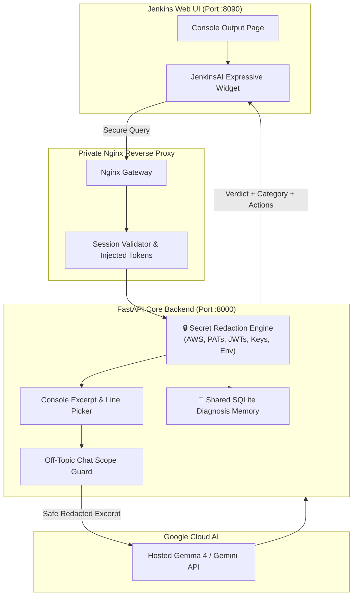

# ⚡ JenkinsAI-Bot 🤖
### *The Autonomous, Zero-Leakage AI Copilot for Jenkins CI/CD Pipelines*

<p align="center">
  
  
  
  
  
  
</p>

---

## 🚀 The Vision: Stop Wasting Hours on 5,000-Line Jenkins Logs

When a build fails, developers scramble through endless terminal logs, while DevOps engineers get pinged constantly:
> *"Is this failing because of my code, or did the runner / node / Docker daemon crash?"*

**JenkinsAI-Bot solves this in under 3 seconds.**
Embedded seamlessly inside your Jenkins UI, it diagnoses pipeline builds in real time, classifies issues into **Application Code vs DevOps / Infra**, redacts leaked secrets on-the-fly, and gives you actionable fixes in **English & Hinglish**.

```
   ┌─────────────────────────────────────────────────────────────┐
   │ 🤖 JenkinsAI: Build #42 FAILED                              │
   │ [ CATEGORY: APPLICATION CODE ISSUE ]                        │
   │                                                             │
   │ 🔍 Evidence: line 412 "npm ERR! Missing dependency: react"  │
   │ 💡 Next Step: Add react to package.json and run npm install │
   └─────────────────────────────────────────────────────────────┘
```

---

## 🔥 Killer Features

| Feature | Description | Impact |
| :--- | :--- | :--- |
| ⚡ **Instant Root Cause Analysis** | Uses Google Gemma 4 via Gemini API to read 2MB+ logs and deliver a 1-sentence verdict & line-level evidence. | **95% faster triage** |
| 🎯 **App vs DevOps Classifier** | Automatically tags root cause as `APPLICATION` (developer's bug) or `DEVOPS` (infra/runner failure). | **Zero unnecessary escalation** |
| 🛡️ **Zero-Leak Secret Redaction** | Strips AWS Keys, GitHub PATs, JWTs, Google API keys, database URLs, and `.env` passwords *before* any LLM payload is dispatched. | **100% Secure & Compliant** |
| 💬 **Interactive DevTools Chat** | Ask follow-up questions or target other pipelines naturally: `"check pipeline testing build 1"` in English or Hinglish! | **Frictionless workflow** |
| 🧠 **Automatic Shared Memory** | After a complete, evidence-backed issue diagnosis, stores a redacted cause and error fingerprint in the server's shared SQLite database—no button or manual confirmation. | **Every user benefits from recurring patterns** |
| 🌗 **Theme-aware Jenkins widget** | Compact diagnosis, follow-up chat, readable evidence, and light/dark colors that follow Jenkins. | **Fits your Jenkins UI** |
| 🔍 **Hidden Failure Detection** | Detects silently failing background jobs or unresolved exceptions even when Jenkins marks `SUCCESS`. | **No silent escapes** |

---

## 🛠️ Architecture & Security Firewall



---

## ⚡ Quick Start

### 1. Clone & Set Up Environment
```bash
git clone https://github.com/DEV-GHILDIYAL/JenkinsAI-Bot.git
cd JenkinsAI-Bot
python3 -m venv .venv

# Linux / WSL / macOS
source .venv/bin/activate
# Windows PowerShell
# .\.venv\Scripts\Activate.ps1

pip install -r requirements-dev.txt
cp .env.example .env
```

### 2. Configure Environment (`.env`)
```ini
DEMO_MODE=false
GEMMA_MODEL=gemma-4-26b-a4b-it
GEMINI_API_KEY=your_gemini_api_key_here
JENKINS_URL=http://127.0.0.1:8080
JENKINS_USER=assistant-reader
JENKINS_API_TOKEN=your_jenkins_api_token
ASSISTANT_TOKEN=generate_random_secret_string_32_chars
JENKINS_FRAME_ORIGIN=http://127.0.0.1:8080
```

### 3. Run Backend Server
```bash
# Production FastAPI runner
uvicorn backend.app:create_app --factory --host 127.0.0.1 --port 8000
```

---

## ☁️ EC2 One-Click Deployment

Deploy in under 2 minutes on an Ubuntu EC2 instance:

```bash
# Initial complete setup
sudo bash ./deploy/install.sh

# Anytime you push code updates
sudo bash ./deploy/update.sh
```

The automated script handles:
- ✅ Virtualenv creation & Python dependencies
- ✅ Systemd service (`jenkinsai.service`) setup & autorestart
- ✅ Nginx reverse proxy configuration on `:8090`
- ✅ Dynamic script injection into Jenkins Console pages

## 🧠 Shared pipeline memory

JenkinsAI automatically remembers a diagnosis after it identifies an `ISSUE` or `FAILED` build **and** has a recognizable error fingerprint, a cited log line, a next step, and a complete log excerpt. There is no remember button or per-user confirmation. The memory belongs to the JenkinsAI server/database: all people using the same JenkinsAI instance share the accumulated patterns, so one team's recurring agent/setup error can help another team on that instance.

Only the normalized error fingerprint (a one-way hash), redacted short cause/next-step text, and source job/build reference are persisted. Raw console logs are not saved. This is shared server-side memory that helps future analyses; it does not train or change the hosted Gemma model. A matching diagnosis is offered to the model as a clue—not treated as proof—and the current build evidence remains authoritative. Similar but non-identical error text may not match.

Separate JenkinsAI installations have separate databases and do **not** share memory merely because they use the same model/API provider. On the systemd deployment the shared database is `/var/lib/jenkinsai/memory.sqlite3`; it persists across app updates. See [deployment notes](docs/DEPLOYMENT.md) for storage and backup details.

---

## 🧪 Testing & Verification

Every pull request is validated against strict security, authorization, and model-safety test suites:

```bash
pytest -v
```

```
tests/test_memory.py ......................... PASSED [100%]
tests/test_monitor.py ........................ PASSED [100%]
tests/test_safety.py ......................... PASSED [100%]
All tests pass with `pytest -v`.
```

- 🛡️ **Secret Sanitization**: Verified against AWS tokens, GitHub PATs, JWTs, and private keys.
- 🛡️ **Path Traversal**: Protects against directory escaping and malicious job naming.
- 🛡️ **Off-Topic Refusal**: Guardrail prevents arbitrary chat or non-Jenkins prompts before reaching LLM.

---

## 💻 CLI Companion: Terminal Coding Assistant

Need to debug code right from your terminal without opening a browser?

```bash
python terminal_assistant.py --root .
```

- `/file backend/jenkins.py` - Previews and inspects files safely.
- `/attach` - Attaches specific context to your next query.
- Completely sandboxed: Proposes code diffs without touching your disk or running unauthorized shell commands.

---

## 🏆 Hackathon Context

Built with ❤️ for **Hacktoberfest Mumbai 2026 — AI Belongs to Everyone**.  
- **Model**: Google Gemma 4 (`gemma-4-26b-a4b-it` / `gemma-4-31b-it`) hosted via Gemini API.
- **License**: [MIT](LICENSE)

<p align="center">
  <b>Built to make Developer and DevOps lives easier. Never waste time on broken builds again! 🚀</b>
</p>
